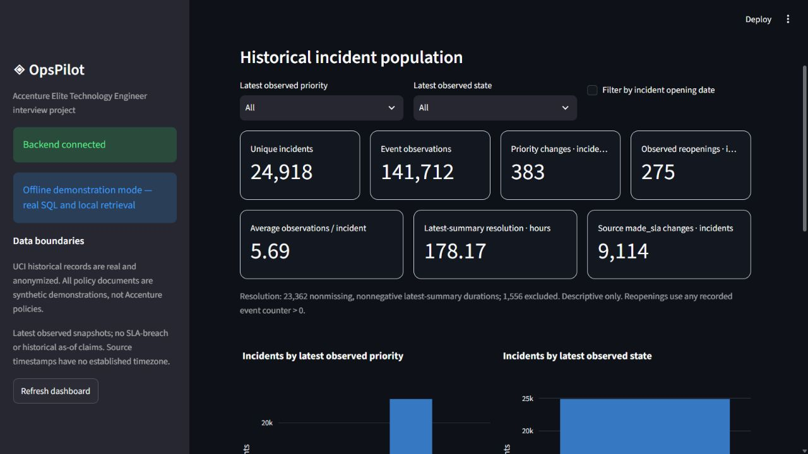

# OpsPilot — Agentic Knowledge & Analytics Copilot

OpsPilot is a **local, evidence-grounded incident analytics and knowledge retrieval application**. It combines structured incident analysis in SQLite with retrieval from a versioned demonstration policy collection. A compiled LangGraph workflow routes user questions to analytics, policy retrieval, or both, and returns the relevant data, source references, and execution trace.

The project uses historical incident data and **synthetic demonstration policies**. It is a technical prototype, not a live incident-management system or an implementation of any organization's internal policies.



## Features

- **Incident analytics:** Counts and distributions by latest observed priority and state, monthly opening trends, assignment groups, event counts, observed priority and `made_sla` changes, reopenings, and descriptive resolution durations.
- **Incident explorer:** Latest incident summary and complete recorded observation history.
- **Policy retrieval (RAG):** Retrieves cited passages from eight synthetic Markdown policies using local `all-MiniLM-L6-v2` embeddings and a persistent Chroma index.
- **Agentic routing:** A compiled LangGraph routes questions through `POLICY`, `ANALYTICS`, `HYBRID`, or `UNSUPPORTED` paths, then validates and composes the result.
- **Transparent evidence:** Responses expose the selected route and tools, applied parameters, supporting passages, structured analytics, and execution trace.
- **Local-first operation:** A deterministic offline mode works without paid API credentials. An optional compatible LLM endpoint can assist with planning and evidence selection.
- **API and dashboard:** FastAPI endpoints and a Streamlit interface with Plotly visualizations.

## Architecture

```text
Streamlit interface
      |
      v
FastAPI REST API
      |
      v
Compiled LangGraph workflow
  parse -> classify -> route -> validate -> compose
                       |
            +----------+----------+
            |                     |
      Analytics tools        Policy retriever
      (read-only SQLite)     (Chroma + embeddings)
            |                     |
            +----------+----------+
                       |
           Structured results + citations
```

Application analytics use predefined, validated operations rather than arbitrary SQL generated by a model. SQL reads use parameterized filters and read-only connections.

See [Architecture](docs/ARCHITECTURE.md) and the [Implementation Guide](docs/IMPLEMENTATION_GUIDE.md) for the detailed design and request walkthroughs.

## Technology stack

Python 3.12, FastAPI, Pydantic, pandas, SQLite, LangGraph, ChromaDB, sentence-transformers, Streamlit, Plotly, python-dotenv, HTTPX, and pytest.

- [requirements.txt](requirements.txt) — direct dependencies.
- [requirements.lock.txt](requirements.lock.txt) — resolved dependencies from the validated Windows/Python 3.12 environment.
- [docs/ENVIRONMENT.json](docs/ENVIRONMENT.json) — recorded package and model versions.

No Docker setup or external database service is required for local use.

## Dataset and policy attribution

### Incident data

OpsPilot expects **four cleaned input files** in `data/`:

| File | Purpose |
| --- | --- |
| `incident_events_clean.csv` | Individual recorded event observations |
| `incident_summary.csv` | One latest-observed summary per incident |
| `latest_selection_ties.csv` | Audit of ties in latest-record selection |
| `data_quality_report.json` | Data quality and provenance metadata |

These inputs are derived from the [UCI Incident management process enriched event log](https://archive.ics.uci.edu/dataset/498/incident+management+process+enriched+event+log), attributed to Amaral, C., Fantinato, M., and Peres, S. (2018), [DOI: 10.24432/C57S4H](https://doi.org/10.24432/C57S4H). The UCI dataset is distributed under [CC BY 4.0](https://creativecommons.org/licenses/by/4.0/). The cleaned files add normalized state fields, source row identifiers, incident summaries, and quality checks. The raw UCI download is **not** a drop-in replacement for these four cleaned files.

The documented analysis covers **141,712 observations** representing **24,918 unique incidents**. Events retain every observation, while summaries have one selected latest-observed record per incident. Missing values and source distinctions are preserved rather than silently imputed. See [Data Schema](docs/DATA_SCHEMA.md) and [Input Hashes](docs/INPUT_HASHES.json).

**Before running from a fresh clone:** Confirm that the four exact cleaned files exist under `data/`. If the published repository does not include them, database initialization will fail until the matching inputs are supplied. Their required SHA-256 hashes are recorded in `docs/INPUT_HASHES.json`.

### Demonstration knowledge base

The `knowledge_base/` directory is expected to contain **eight synthetic Markdown policies** created for this project. They are not real company procedures or UCI-supplied documents and should not be used to establish historical compliance. The indexer splits them into 24 documented section chunks.

**Before indexing:** Confirm that these Markdown files are present. An empty or missing `knowledge_base/` cannot produce the documented policy index.

## 📂 Dataset

OpsPilot uses the UCI Incident Management Process Dataset,
containing 141,712 event records and 24,918 unique incidents.

The cleaned dataset is available under
[GitHub Releases](https://github.com/manish-thakur02/OpsPilot/releases/latest).

Download `opspilot-data-v1.zip` and extract its four files into
the `data/` folder before running the application.

Source: UCI Machine Learning Repository (CC BY 4.0).

## Setup (Windows PowerShell)

Use a **64-bit Python 3.12** installation. Run the following commands from the project root in PowerShell, after confirming that `data/` and `knowledge_base/` contain their required inputs:

```powershell
py -3.12 -m venv .venv312
.\.venv312\Scripts\python.exe -m pip install -r requirements.lock.txt
.\.venv312\Scripts\python.exe -m pip check
Copy-Item .env.example .env
.\.venv312\Scripts\python.exe -m scripts.inspect_data
.\.venv312\Scripts\python.exe -m scripts.init_db
.\.venv312\Scripts\python.exe -m scripts.ingest_policies
```

The virtual environment, generated SQLite database, Chroma index, and embedding model cache are local artifacts; they are **not included in a Git checkout**. `scripts.init_db` creates the database from the cleaned inputs. `scripts.ingest_policies` creates the Chroma index and, on first use, downloads the public embedding model (approximately 90 MB of weights plus supporting files). A paid API key is not required for offline mode. Repeated indexing reuses an unchanged index.

If `.env` is already configured, do not overwrite it. The `inspect_data` command is read-only unless explicitly run with `--write-schema`, which updates `docs/DATA_SCHEMA.md`. Stop the application before updating the policy index, and do not run concurrent index writers.

## Run the application

Start **two separate PowerShell terminals** in the project root.

**Terminal 1 — FastAPI backend**

```powershell
.\.venv312\Scripts\python.exe -m uvicorn app.main:app --host 127.0.0.1 --port 8000
```

**Terminal 2 — Streamlit dashboard**

```powershell
.\.venv312\Scripts\python.exe -m streamlit run frontend/streamlit_app.py --server.address 127.0.0.1 --server.port 8501 --server.headless true --browser.gatherUsageStats false
```

Open the local [dashboard](http://127.0.0.1:8501/), [API documentation](http://127.0.0.1:8000/docs), or [health endpoint](http://127.0.0.1:8000/health). Stop either server with `Ctrl+C`. The URLs point to services running on **your computer**; they are not public deployment links.

If port 8501 is in use, check whether Streamlit is already running or choose a different dashboard port. A "Backend unavailable" message means the backend is not reachable at the configured `OPSPILOT_API_URL`.

## Modes and configuration

**Offline mode (default):** Uses deterministic question routing, real SQLite analytics, and retrieved policy passages. Retrieved passages are labeled as retrieval-only evidence rather than presented as LLM-generated reasoning. Offline language support is intentionally limited; ambiguous requests ask for clarification, and unsupported ones return examples.

**Optional LLM-assisted mode:** In `.env`, set `LLM_API_KEY`, `LLM_MODEL`, and a compatible `LLM_BASE_URL`; `LLM_TIMEOUT` is optional. Provider planning uses a JSON chat-completions interface, validates tool selections, and uses evidence IDs to ground responses. Invalid or failed provider responses trigger visible fallback behavior. **Live paid-provider requests were not part of the recorded validation**; that path was tested with mocked HTTP responses.

Other settings, including `OPSPILOT_DB`, `OPSPILOT_CHROMA`, `OPSPILOT_MODEL_CACHE`, `OPSPILOT_EMBEDDING_MODEL`, and `OPSPILOT_API_URL`, are documented in [.env.example](.env.example). Relative filesystem paths resolve from the project root. Changing the embedding model requires a new Chroma directory and reindexing.

## REST API

| Method | Endpoint | Purpose |
| --- | --- | --- |
| GET | `/health` | Database readiness, index-manifest readiness, and configured mode |
| GET | `/data/summary` | Incident/event counts and summary statistics |
| GET | `/analytics/priorities` | Latest-observed incident priority distribution |
| GET | `/analytics/states` | Latest-observed normalized state distribution |
| GET | `/analytics/trends` | Monthly incident opening trends |
| GET | `/incidents/{incident_id}` | Latest summary and full recorded history |
| POST | `/analytics/query` | Validated analytics tool and filter request (not arbitrary SQL) |
| POST | `/chat` | Question, route, evidence, analytics and execution trace |

Population endpoints accept supported filters such as `priority`, `state`, `assignment_group`, `start_date`, and `end_date`. Date filters refer to **incident opening dates**, not event-update dates. Consult `/docs` for complete request and response schemas.

```powershell
Invoke-RestMethod http://127.0.0.1:8000/data/summary
Invoke-RestMethod -Method Post -Uri http://127.0.0.1:8000/chat -ContentType 'application/json' -Body '{"question":"How many unique incidents are present in the dataset?"}'
```

## Example questions

1. How many unique incidents are present in the dataset?
2. Show the distribution of incidents by latest observed priority.
3. What is the illustrative procedure for escalating a critical incident?
4. Find the escalation policy and show the number of incidents in the corresponding priority category.
5. Show the recorded history of `INC0000045`.

The offline router also supports documented variations, including `How many critical tickets are there?` and `Awaiting User Information`. A phrase such as `urgent ticket` prompts clarification rather than automatically classifying the request as critical priority. The app cannot create, assign, or update tickets.

## Recorded results and validation

The project's [Validation Report](docs/VALIDATION.md) records local testing on **October 23–24, 2026**. The reported October 24 regression run passed **80 tests**. Earlier recorded checks included 10/10 acceptance questions, database integrity, repeatable imports, policy indexing, and a frontend AppTest against a running backend. These are **recorded local results**, not claims of an independent rerun on a fresh GitHub clone.

Selected metrics from the documented dataset:

| Metric | Result |
| --- | ---: |
| Event observations | 141,712 |
| Unique incidents | 24,918 |
| Latest Critical / High / Moderate / Low | 270 / 408 / 23,466 / 774 |
| Incidents with observed priority changes | 383 |
| Incidents with observed `made_sla` changes | 9,114 |
| Incidents with any observed reopening counter > 0 | 275 |
| Valid latest-summary resolution durations | 23,362 |
| Excluded resolution durations | 1,556 |
| Mean valid resolution duration | 178.17 hours |

All latest incident summaries in this historical dataset happen to be **Closed**; individual observation histories contain other states. The `made_sla` source field is **not** interpreted as verified SLA compliance or breach.

To run the project checks locally:

```powershell
.\.venv312\Scripts\python.exe -m pytest -q
.\.venv312\Scripts\python.exe -m scripts.smoke_test
# With the backend already running:
.\.venv312\Scripts\python.exe -m scripts.smoke_test --url http://127.0.0.1:8000
.\.venv312\Scripts\python.exe -m scripts.verify_frontend
```

Some tests need the four cleaned input files; the real retrieval smoke test also needs the downloaded embedding model and initialized policy index. Generated reports live in `runtime/` and are not committed.

## Project structure

```text
OpsPilot/
├── app/                 Backend, analytics, routing and RAG
│   ├── agents/          Compiled graph and router
│   ├── api/             HTTP routes and response schemas
│   ├── database/        Input validation, ingestion and SQL access
│   ├── rag/             Policy indexing and retrieval
│   └── services/        Analytics and optional LLM integration
├── frontend/            Streamlit dashboard
├── scripts/             Validation, initialization and smoke checks
├── tests/               Unit and integration tests
├── docs/                Architecture, schema, implementation and validation
├── data/                Four cleaned data inputs (required)
├── knowledge_base/      Eight synthetic policies (required)
├── runtime/             Generated local artifacts (Git-ignored)
├── .env.example
├── .gitignore
├── requirements.txt
├── requirements.lock.txt
└── README.md
```

## Limitations and responsible use

- This is a **local, single-user technical prototype**, not a hardened production system. It has no authentication, multi-user isolation, or production-grade access controls. Do not expose it publicly without appropriate security work.
- Analysis is descriptive and tied to the historical dataset. It is not an operational backlog, a forecasting system, or a point-in-time historical reconstruction.
- The policy corpus is synthetic. Retrieved procedures are examples and do not establish real organizational rules or historical compliance.
- Missing source values remain unknown. Resolution statistics exclude missing/invalid durations; no data is fabricated to fill gaps.
- Retrieval uses a cosine-distance threshold of `0.55`, not a calibrated confidence probability or comprehensive relevance benchmark.
- The offline router supports a bounded question grammar, not general-purpose autonomous ticket management.
- The application has **not been publicly deployed**. Publishing this repository shares source code; it does not host the FastAPI backend or Streamlit dashboard.

Do not commit `.env`, private credentials, virtual environments, local databases, model caches, or generated `runtime/` files. Review dataset redistribution permissions and policy content before publishing.

## References

- [UCI Incident management process enriched event log](https://archive.ics.uci.edu/dataset/498/incident+management+process+enriched+event+log)
- [LangGraph compilation](https://reference.langchain.com/python/langgraph/graph/state/StateGraph/compile)
- [Chroma documentation](https://docs.trychroma.com/)
- [SentenceTransformers documentation](https://www.sbert.net/docs/package_reference/sentence_transformer/model.html)
