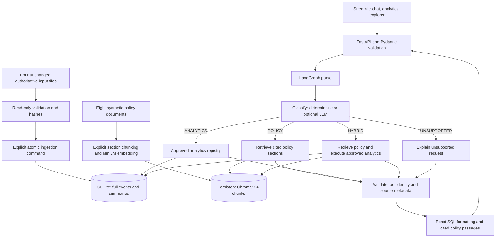

# OpsPilot architecture

OpsPilot answers questions using two independent evidence systems: the real UCI incident database and a synthetic demonstration policy index. A hybrid response keeps those sources separate. There is no claim that illustrative policy governed the historical incidents.

## Runtime and initialization

`scripts.inspect_data` validates CSV structure, observed types, source counts, incident membership, selected-event fields, first/latest observations, derived changes, resolution durations and report consistency. It compares hashes before and after. The schema document records all actual fields. `docs/INPUT_HASHES.json` records the original four SHA-256 hashes for preservation tests.

`scripts.init_db` builds a staging database inside runtime/, inserts summary then events then tie audit in a transaction, verifies counts/references/integrity, closes the connection and atomically replaces the target. Matching input hashes and schema version make repeated initialization a checked no-op. Indexes cover event incident/time, summary priorities, states, dates, assignment group and selected source row. NULL means original information is unknown. Import metadata retains the original report and hashes.

`scripts.ingest_policies` is the only application path that may download embedding weights. It splits by Markdown section, repeats heading context, uses normalized 384-dimensional MiniLM embeddings and stores cosine-search vectors with source metadata. IDs hash filename, heading, position and content. A manifest detects source/model changes, unchanged indexing avoids embeddings, and updates delete stale records. A changed model requires a new index directory. Index maintenance is an explicit single-writer operation; do not run it concurrently with serving or another ingestion.

## Graph state and execution

`CopilotState` contains question, intent, selected tools, validated tool request, evidence, analytics, citations, errors, trace, mode and timings. `build_graph()` returns an actual compiled StateGraph with START, parse, classify, four conditional route nodes, validate, compose and END. Each route executes once; API calls use recursion_limit=12. There is no agent conversation loop, generated Python execution or LLM-written SQL.

The POLICY route retrieves up to three sections. ANALYTICS validates a `ToolRequest` and invokes `Analytics.run()`. HYBRID performs both, independently handles failures and states the illustrative priority assumption. UNSUPPORTED runs no tools. Partial hybrid results carry explicit errors. A wholly failed tool request returns HTTP 503; invalid API shapes return 422 and missing incident lookup returns 404. Retrieval with no relevant evidence says an answer could not be established.

## LLM boundary

With no key/model, routing is a documented rule-based demonstration and policy output is labelled retrieval-only. With a provider configuration, HTTPX calls a compatible chat-completions endpoint with a timeout and requests JSON. Pydantic validates the plan against the same allowlist. Composition asks the model to select evidence IDs, then renders those exact passages; it cannot introduce model-written numerical claims. This conservative extractive design is deliberate. SQL results are formatted by Python in either mode. Invalid provider output or timeouts produce visible offline/fallback notices. Credentials are read from the environment and are not included in API responses.

Retrieved documents are evidence, not instructions. They are not used in planning and cannot introduce tools, execute SQL or override filters. Tests inject hostile document text and verify the tool selection and database stay unchanged. This boundary does not establish that any arbitrary future document is factually trustworthy; adding real documents requires review and access controls.

## Security and scope

The application uses SQLite URI mode=ro and query_only=ON for runtime queries. SQL structure is owned by the application; all user values are bound parameters. Pydantic rejects extra fields, unsupported tools, invalid IDs/categories and reversed date ranges. There is no arbitrary SQL endpoint. Filters select incidents using latest-summary values and inclusive opening dates; all associated observations remain included in an event-population count.

This is a single-user local interview application bound to 127.0.0.1. Authentication, multi-tenant document permissions, external-service hardening and production audit retention are future work. Offline mode requires the initial dependency and model downloads to have completed; afterward policy queries load cached weights with local_files_only=True.
